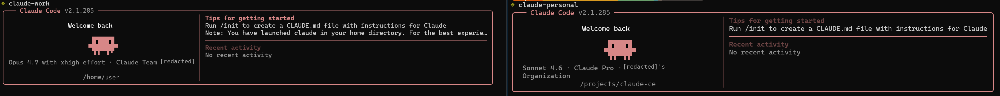

# claude-ce



A tiny shell tool for running multiple Claude Code accounts side-by-side on macOS and Linux/WSL.

---

## What is it

`claude-ce` is a tiny shell tool that lets you run multiple Claude Code accounts (e.g. personal + work) side-by-side on the same machine, without constant logout/login cycles.

Under the hood, it uses Claude Code's officially supported `CLAUDE_CONFIG_DIR` environment variable: each account gets its own config directory, and the tool wires up a shell alias per account. This is not a hack — it's automation around a supported mechanism.

## Why you need it

By default, Claude Code stores its credentials in `~/.claude/`. Only one account can be logged in at a time, so switching accounts means logging out and logging back in, which gets old fast.

With this tool, each account gets its own isolated directory, and you switch by running an alias:

```
claude-work       # launches the work account
claude-personal   # launches the personal account
```

## Install

Two ways, pick one.

### Method 1: curl one-liner

```bash
curl -fsSL https://raw.githubusercontent.com/mdfaridmiah/claude-ce/main/install-remote.sh | bash
```

This installs the script to `~/.local/bin/claude-ce`. If `~/.local/bin` isn't in your `PATH`, the installer will tell you how to add it.

You can also install and add an account in one go:

```bash
curl -fsSL https://raw.githubusercontent.com/mdfaridmiah/claude-ce/main/install-remote.sh | bash -s -- add work
```

### Method 2: git clone

```bash
git clone https://github.com/mdfaridmiah/claude-ce.git
cd claude-ce
chmod +x claude-ce.sh
```

## Usage

### Add an account

```bash
./claude-ce.sh add work
./claude-ce.sh add personal
source ~/.zshrc   # or source ~/.bashrc
```

Example output:

```
✓ Added alias 'claude-work' to ~/.zshrc
✓ Config directory: ~/.claude-work

Next steps:
  1. Reload your shell:      source ~/.zshrc
  2. Launch this account:    claude-work
  3. Log in when prompted (browser will open)
```

### List accounts

```bash
./claude-ce.sh list
```

Example output:

```
claude-work       ->   ~/.claude-work       (exists)
claude-personal   ->   ~/.claude-personal   (exists)
```

### Switch between accounts

After sourcing your rc file, just run the alias:

```bash
claude-work        # launches work account
claude-personal    # launches personal account
```

Each alias launches `claude` with the corresponding `CLAUDE_CONFIG_DIR`. Accounts are fully isolated.

### Remove a single account

```bash
./claude-ce.sh remove personal
```

This removes the alias line only. The account's config directory at `~/.claude-personal` is preserved so your data is safe.

### Uninstall completely

```bash
./claude-ce.sh uninstall
```

Removes the entire managed block from your rc file. All `~/.claude-*` config directories remain untouched.

## How it works

- Creates `~/.claude-<n>` for each account.
- Appends a clearly marked block to `~/.zshrc` or `~/.bashrc` (wrapped by `# >>> claude-ce managed block >>> DO NOT EDIT` … `# <<< claude-ce managed block <<<`).
- Each alias looks like:

  ```
  alias claude-<n>='CLAUDE_CONFIG_DIR=$HOME/.claude-<n> claude'
  ```

- Running `claude-<n>` causes Claude Code to read/write credentials, settings, and session history from the isolated directory. Accounts don't interfere with each other.

## FAQ

**Can I share conversation history between accounts?**

Not automatically. If you really want to, you can manually symlink `~/.claude-<n>/projects` to `~/.claude/projects`. But do NOT share credentials — that defeats the whole isolation purpose.

**What about MCP configuration?**

Each account has its own MCP configuration. If you want the same MCP setup across accounts, either configure each account separately, or manually copy the `.mcp.json` file.

**Does this support native Windows?**

No. Claude Code on Windows has a `~/.claude.json` global-state conflict that makes the simple alias approach unreliable. Please use WSL. The script will also refuse to run under Git Bash, MSYS, or Cygwin — use WSL instead.

**Do I need to run `source ~/.zshrc` every time?**

No. New terminals load the aliases automatically. You only need it once, in a terminal that was already open when you ran add or remove, because a script can't update the shell that launched it.

**What files does this tool modify?**

Exactly two things:

1. Appends a clearly marked block to `~/.zshrc` (or `~/.bashrc`, based on your `$SHELL`).
2. Creates `~/.claude-<n>` directories.

Nothing else is touched. Uninstall removes the managed block but never deletes `~/.claude-<n>` directories, so your data is safe.

## Credits

Built on top of long-standing community practice, using Claude Code's officially supported `CLAUDE_CONFIG_DIR` environment variable (see the [official env-vars docs](https://code.claude.com/docs/en/env-vars)).
